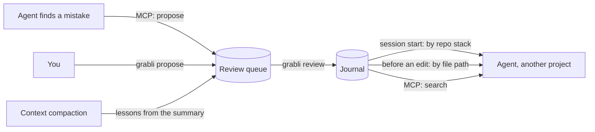

# grabli

> *наступать на те же грабли*: Russian for "to step on the same rake twice".

Your coding agent makes a mistake. Review catches it, you fix it, everyone
moves on. Three weeks later, in a different repository, the agent makes the
same mistake, because nothing it learned survived the session.

grabli is a journal of those mistakes that follows the agent from project to
project, and puts the right entry in front of it at the moment it is about
to repeat one.

## The mistake that started it

A year-to-date report summed from January 1 instead of from the start of the
reporting period. The tests were green and it shipped. The first code review
found it.

In grabli a mistake like that becomes one file (an illustrative entry):

```markdown
---
id: m-k3x9qa
kind: mistake
title: YTD without a reporting period
stack: [nestjs, postgres]
paths: ['**/reports/**', '**/*ytd*']
source: {repo: finance-app, found_by: code-review}
created: 2026-11-22
last_verified: 2026-11-22
---
The report summed from the start of the calendar year. Pass the period
explicitly, and test with dates on both sides of the period boundary.
```

Next time an agent opens `src/reports/anything.ts` in any NestJS project of
yours, it gets this entry before it writes the bug again.

## How it works



Three things make it more than a notes folder:

- **It delivers, the agent does not have to ask.** Hooks match entries
  against the repository's stack at session start and against the file path
  before every edit.
- **Nothing is written without you.** Every draft, whoever proposed it,
  waits for `grabli review`. An agent cannot fill its own memory with noise.
- **It catches lessons that would otherwise be lost.** When Claude Code
  compacts the context, grabli asks the summarizer for the session's
  lessons and queues them as drafts.

## The question

Memory tools for agents are easy to build and rarely measured. This project
is built to answer one thing with numbers: **does a mistake journal reduce
an agent's repeat mistakes?**

The measurements are not done yet. What exists so far are single-run
observations, and they already changed the design:

| Observation (one run each) | Consequence |
|---|---|
| Context added by a pre-edit hook reaches the agent *after* its first edit. It wrote the bug, read the entry, then fixed it. | Added `--block`: refuse the edit once, so the entry is read first. |
| In block mode the buggy version never reached disk. Same number of turns. | Context vs. block is now a condition in the eval, not a guess. |
| Running the agent with global hooks and config loaded took 8 turns; isolated, 3. | Eval runs are isolated from the user's own setup. |

The plan, the conditions, and the metrics are in [docs/SPEC.md](docs/SPEC.md).

## Quick start

Requires Python 3.13, [uv](https://docs.astral.sh/uv/), and Claude Code.

```bash
git clone https://github.com/Baurzhanovvv/grabli.git
cd grabli && uv sync

# connect any project: hooks + MCP server, nothing enters that project's git
uv run grabli install ~/code/my-project
```

Open a new Claude Code session in that project. Then:

```bash
uv run grabli propose "YTD without a reporting period" \
  --body "Summed from January 1. Pass the period explicitly." \
  --stack nestjs --paths '**/reports/**'

uv run grabli review        # accept, reject or skip each draft
uv run grabli search "report period"
```

Or just tell the agent: *"log this mistake in grabli"*.

## Commands

| Command | What it does |
|---|---|
| `grabli install [path] [--block] [--no-mcp]` | Connect a project to the journal |
| `grabli propose <title> [--body ...]` | Queue a draft by hand |
| `grabli review` | Walk the queue |
| `grabli pending` / `accept <id>` / `reject <id>` | Queue operations |
| `grabli search <query>` | Search the journal |
| `grabli serve` | MCP server with two tools: `search`, `propose` |
| `grabli hook <event>` | Hook handlers, called by Claude Code |

The journal lives in `~/.grabli` (`GRABLI_HOME` changes that) as plain
Markdown files. Edit them by hand, keep them in git; the search index
rebuilds itself.

## Design choices

- **Files are the source of truth.** The SQLite index and the event log can
  be deleted at any time.
- **Two entry kinds, not a knowledge base.** `mistake` and `decision`.
- **No embeddings yet.** Search is SQLite FTS5 with BM25 and Russian
  stemming. Embeddings get added if the retrieval eval shows a measurable gain.
- **Broken memory never breaks work.** A failing hook exits 0 and logs the error.
- **Every delivery is logged**, so the evals read what actually happened.

## Limitations

- Search is lexical. A query with no shared word stems finds nothing.
- The secret check on proposed entries is a list of regular expressions, not a guarantee.
- Compaction capture depends on the summarizer following instructions.
  It has been observed working once, on a manual `/compact`.
- Claude Code only. The MCP tools work with any client, the hooks do not.

## Development

```bash
uv sync
uv run pytest
uv run ruff check . && uv run ruff format --check .
```

The full behavior is specified in [docs/SPEC.md](docs/SPEC.md). A change in
behavior updates the spec in the same commit.
